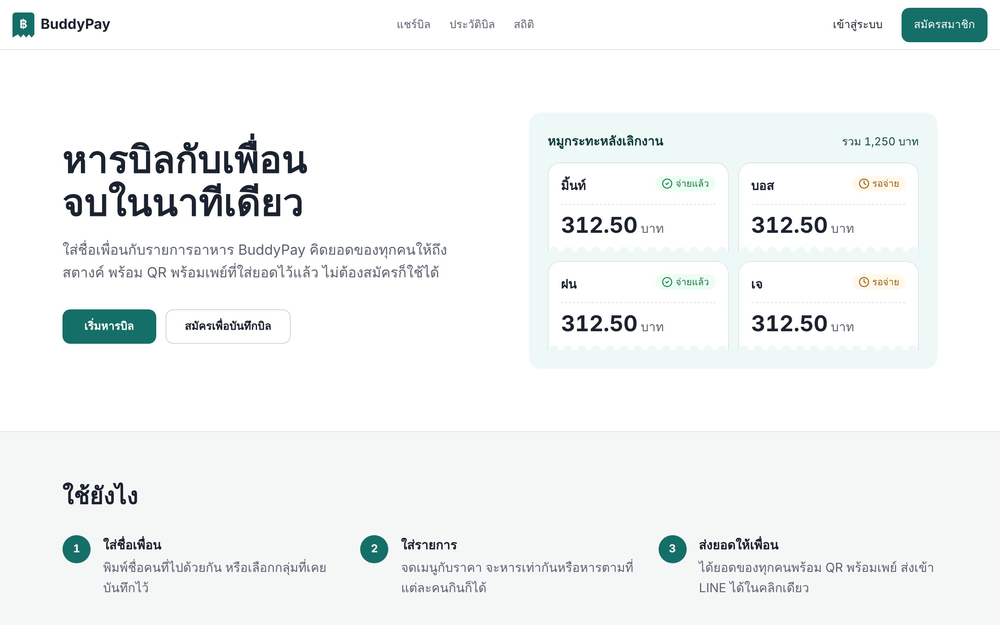

# BuddyPay

**Split a restaurant bill with friends in under a minute — down to the satang — and get a PromptPay QR for each person.**

[](https://github.com/anuchanamlee/Buddy-pay/actions/workflows/ci.yml)
[](LICENSE)


**Live demo:** https://buddy-pay-eta.vercel.app · **Design system:** [/design](https://buddy-pay-eta.vercel.app/design) · **ภาษาไทย:** [README.th.md](README.th.md)



| Enter the bill | Who pays what | PromptPay QR per person | Quick split |
|---|---|---|---|
|  |  |  |  |

---

## Why this project

Splitting a Thai restaurant bill is fiddly: some people didn't drink the beer, there's 7% VAT and a 10% service charge, a discount at the end, and then everyone needs to transfer an odd amount like 249.67 baht. BuddyPay turns that into **one screen of input → one screen of results**:

- **2 screens, ~9 taps** for a typical bill (the first version had 5 steps and 18 taps — measured by the E2E test).
- **Every item starts as "everyone ate this"**; tap a name to remove someone. No "split method" to choose.
- **Exact money math in integer satang** with largest-remainder allocation, so the per-person amounts always add up to the bill (100 ÷ 3 = 33.34 + 33.33 + 33.33).
- **A PromptPay QR with each person's amount** already filled in, plus a share link and "send to LINE".
- **Works without an account.** Sign in only if you want to save the bill and tick off who has paid.

## Features

| Feature | Details |
|---|---|
| Itemized split | Add people and items with the keyboard only (Enter moves to the next field); per-item eaters; VAT, service charge and discount |
| Quick split | Just the receipt total and the number of people |
| PromptPay QR | EMVCo payload with amount per person; the PromptPay ID is remembered on the device |
| Share link | Public read-only link, expires after 24 hours (validated with zod, rate limited) |
| History | Saved bills, mark people as paid (Firestore transaction prevents lost updates), edit and delete |
| Statistics | Monthly spending and categories (Recharts), who still owes you |
| Auth | Email/password and Google sign-in (Firebase Auth); signing in mid-flow keeps the bill |
| Admin | User management and overview for `role: admin` |
| Design system | Tokens and components documented at `/design` |
| Install on phone (PWA) | Add to home screen on iPhone and Android, Android long-press shortcuts, a separate "quick split" icon, works offline for splitting (`/install`) |
| Badge and reminders | Unpaid count on the app icon; optional daily Web Push reminder via Vercel Cron (free) |

## Tech stack

**Next.js 15** (App Router) · **React 19** · **TypeScript** · **Tailwind CSS v4** · **Firebase Auth + Cloud Firestore** · **zod** · **Vitest** · **Playwright** · **GitHub Actions** · **Vercel**

## Architecture

```
Browser (Next.js / React)
 ├─ Firebase Auth SDK ── sign-in, ID token
 ├─ Firestore SDK ───── bills, users, groups (direct reads/writes) ──┐
 └─ fetch ─> Next.js API routes                                     │
             POST /api/share/create  zod + rate limit ──────────────┤
             GET  /api/share/[id]    expiry check ──────────────────┤
                                                                    ▼
                                     Cloud Firestore — firestore.rules is the authorization layer
```

**Built for the free Spark plan:** a persistent local Firestore cache, a navbar listener that only watches unpaid bills, statistics capped to the latest 300 bills, and server-side count/sum aggregation on the admin dashboard keep reads low.

Because the browser talks to Firestore directly, **Firestore Security Rules are the backend authorization**: deny-by-default, owner-only access to bills and groups, users cannot change their own `role`/`status`, share links can be read by ID but never listed. The rules have their own test suite running on the Firestore emulator.

Key code:

| Path | What it does |
|---|---|
| `app/lib/money.ts` | Satang conversion and largest-remainder allocation |
| `app/lib/billCalculator.ts` | The single source of truth for per-person amounts |
| `app/lib/billDraft.ts` | Pure functions for editing a bill (add person/item, toggle eater, validation) |
| `app/components/bill/` | Bill editor, quick split, result screen |
| `app/lib/share/` | Share-link schema and handler |
| `firestore.rules` | Security rules (tests in `tests/rules/`) |
| `e2e/flow.mjs` | Real-browser user-flow test |

## Run it yourself

### 1. Try it locally without Firebase (2 minutes)

The bill calculator, QR codes and result screen work without a real Firebase project.

```bash
git clone https://github.com/anuchanamlee/Buddy-pay.git
cd Buddy-pay
npm ci
cp .env.example .env.local
# put any placeholder values, e.g.
#   NEXT_PUBLIC_FIREBASE_API_KEY=demo-key
#   NEXT_PUBLIC_FIREBASE_PROJECT_ID=demo-buddypay
npm run dev        # http://localhost:3000/share-bill
```

Sign-in, saving bills and share links need a real Firebase project (step 2).

### 2. Connect your own Firebase project (free Spark plan is enough)

1. Create a project at [console.firebase.google.com](https://console.firebase.google.com).
2. **Authentication → Sign-in method:** enable **Email/Password** and **Google**. Add `localhost` and your deploy domain under **Authorized domains**.
3. **Firestore Database:** create a database (production mode).
4. **Project settings → Your apps → Web app:** copy the config into `.env.local` (`NEXT_PUBLIC_FIREBASE_*`). These values are public by design; security comes from the rules.
5. Deploy the rules and indexes with the [Firebase CLI](https://firebase.google.com/docs/cli):
   ```bash
   npm i -g firebase-tools
   firebase login
   firebase use --add          # pick your project
   firebase deploy --only firestore:rules,firestore:indexes
   ```
6. *(Optional)* **Firestore → TTL policies:** collection `temporary_shared_bills`, field `expiresAt` — deletes expired share links automatically.
7. *(Optional)* To make yourself an admin, sign up once, then in Firestore set `users/{your uid}.role` to `"admin"`.
8. `npm run dev` and sign in.

### Optional: daily payment reminders (Web Push)

Free: Vercel Cron calls `/api/cron/reminders` once a day (18:00 Thailand, `vercel.json`). Without these variables the feature stays off.

1. Generate keys on your machine: `npx web-push generate-vapid-keys`
2. In Vercel → Settings → Environment Variables add `NEXT_PUBLIC_VAPID_PUBLIC_KEY`, `VAPID_PRIVATE_KEY`, `VAPID_SUBJECT` (e.g. `mailto:you@example.com`), `CRON_SECRET` (any long random string) and `FIREBASE_SERVICE_ACCOUNT` (the JSON from Firebase → Project settings → Service accounts → Generate new private key, pasted as one line). The private key, service account and cron secret are secrets — never commit them.
3. Deploy the updated rules: `firebase deploy --only firestore:rules`
4. Redeploy, open `/install` on your phone, and turn on notifications. On iPhone, add the app to the home screen first (iOS 16.4+).

### 3. Deploy to Vercel

Import the repo in Vercel, add the same `NEXT_PUBLIC_FIREBASE_*` environment variables (and optionally `NEXT_PUBLIC_APP_URL`), deploy, then add the Vercel domain to Firebase **Authorized domains**.

## Scripts

| Command | Description |
|---|---|
| `npm run dev` | Dev server (Turbopack) |
| `npm run build` / `npm start` | Production build / server |
| `npm run typecheck` | TypeScript, including tests |
| `npm run lint` | ESLint |
| `npm test` | Unit tests (Vitest, 93 tests, no Firebase needed) |
| `npm run test:rules` | Firestore rules tests on the emulator (needs Java 21) |
| `npm run test:e2e` | Playwright user flow (41 checks) against `npm run build && npx next start -p 3100` |

## Testing and CI

GitHub Actions runs on every pull request and every push to `main`:

1. **Quality** — typecheck, lint, unit tests, production build
2. **Firestore rules** — data isolation between users on the emulator, offline demo project
3. **E2E** — Playwright drives the built app: keyboard-only entry, per-item eaters, VAT/service/discount, quick split, invalid input, refresh keeps the bill, no horizontal overflow at 360 px

No secrets are needed for CI.

## Known limitations and roadmap

- The share API writes with the client SDK → move to the Firebase Admin SDK and close client writes in the rules.
- Middleware checks a client-set cookie (redirect only; data is protected by the rules) → server-issued session cookies.
- In-memory rate limit per server instance → a shared store such as Upstash Redis.
- CSP still allows `'unsafe-inline'` → nonces.
- No E2E for sign-in/saving yet → Firebase Auth + Firestore emulators in E2E.

## Contributing

Issues and pull requests are welcome — see [CONTRIBUTING.md](CONTRIBUTING.md).

## License

[MIT](LICENSE) © Anucha Namlee
