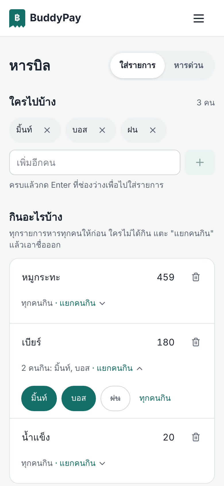
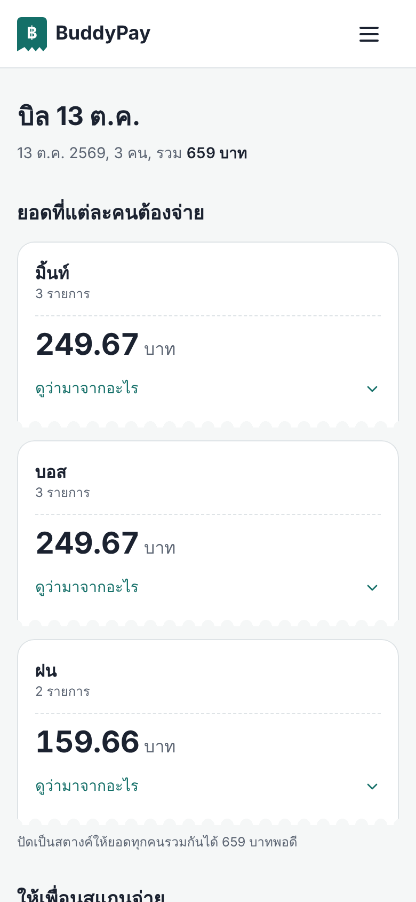
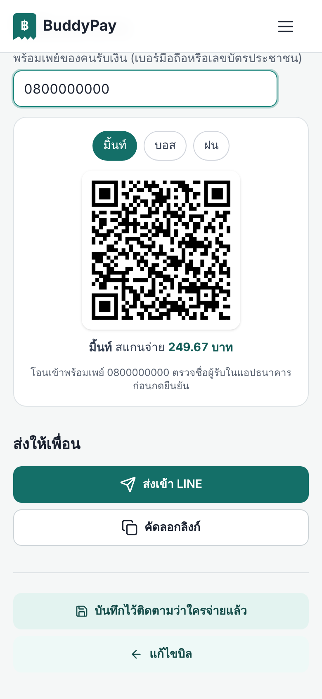
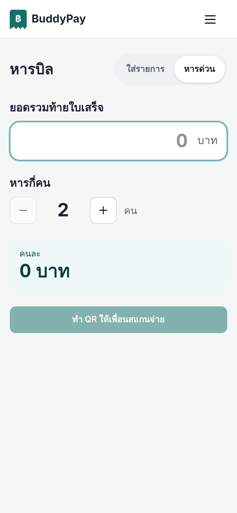

# BuddyPay

เว็บแอปสำหรับ **แบ่งบิลค่าอาหารและค่าใช้จ่ายระหว่างเพื่อน** คำนวณ VAT ค่าบริการ และส่วนลด สร้าง QR PromptPay สำหรับรับเงิน แชร์ผลลัพธ์ผ่านลิงก์ และติดตามว่าใครยังค้างจ่าย

สร้างด้วย Next.js 15 (App Router), React 19, TypeScript และ Firebase (Authentication + Firestore)

> **ใช้งานจริง:** https://buddy-pay-eta.vercel.app · ดู design system ได้ที่ [`/design`](https://buddy-pay-eta.vercel.app/design)
>
> **English:** [README.md](README.md) · โอเพนซอร์สภายใต้ [MIT License](LICENSE) โคลนไปใช้หรือพัฒนาต่อได้

| ใส่บิล | ยอดของแต่ละคน | QR พร้อมเพย์รายคน | หารด่วน |
|---|---|---|---|
|  |  |  |  |

---

## สารบัญ

- [ฟีเจอร์](#ฟีเจอร์)
- [สถาปัตยกรรม](#สถาปัตยกรรม)
- [โมเดลความปลอดภัย](#โมเดลความปลอดภัย)
- [โครงสร้างโปรเจกต์](#โครงสร้างโปรเจกต์)
- [การติดตั้งและรันในเครื่อง](#การติดตั้งและรันในเครื่อง)
- [ใช้ Firebase ของคุณเอง](#ใช้-firebase-ของคุณเอง)
- [การทดสอบ](#การทดสอบ)
- [CI](#ci)
- [การ Deploy](#การ-deploy)
- [ข้อจำกัดที่ทราบ](#ข้อจำกัดที่ทราบ)
- [แนวทางพัฒนาต่อ](#แนวทางพัฒนาต่อ)
- [License](#license)

---

## ฟีเจอร์

| ฟีเจอร์ | รายละเอียด | ไฟล์หลัก |
|---|---|---|
| หารบิล 2 หน้า | หน้าเดียวใส่ชื่อเพื่อนและรายการ (พิมพ์ต่อด้วย Enter, แยกคนกินในรายการ, ไม่ต้องเลือกวิธีหาร) → หน้าผลลัพธ์ บิลง่าย ๆ ใช้ 2 หน้า กด 9 ครั้ง (เดิม 5 หน้า 18 ครั้ง) | `app/share-bill/page.tsx`, `app/components/bill/`, `app/lib/billDraft.ts` |
| หารด่วน | ใส่ยอดท้ายใบเสร็จกับจำนวนคน ได้ยอดต่อคนและ QR ทันที | `app/components/bill/QuickSplit.tsx` |
| คำนวณการหารบิล | VAT คิดจากค่าอาหาร ค่าบริการคิดจากยอดหลัง VAT ส่วนลดแบ่งตามสัดส่วน **คิดเป็นสตางค์** ยอดทุกคนรวมได้เท่ายอดบิลพอดี (100 หาร 3 = 33.34, 33.33, 33.33) | `app/lib/billCalculator.ts`, `app/lib/money.ts` |
| QR PromptPay ของแต่ละคน | เลือกชื่อแล้วได้ QR ที่ใส่ยอดของคนนั้น จำเลขพร้อมเพย์ไว้ในเครื่อง | `app/components/PromptPayQR.tsx` |
| ลิงก์แชร์ชั่วคราว | แชร์ผลการหารบิลได้โดยไม่ต้องล็อกอิน ลิงก์มีอายุ 24 ชั่วโมง | `app/api/share/`, `app/lib/share/` |
| บันทึกและประวัติบิล | บันทึกบิลลง Firestore (ล็อกอินกลางทางแล้วบิลไม่หาย) ติ๊กคนที่จ่ายแล้วได้จากหน้าประวัติ (transaction กันเขียนทับ) แก้และลบบิลได้ | `app/bill-history/`, `app/bill/[id]/`, `app/components/history/` |
| ผู้ค้างชำระ | สรุปว่าใครยังไม่จ่ายและยอดเท่าไร ทั้งในหน้าสถิติและแจ้งเตือนบน Navbar (real-time) | `app/hooks/useStatistics.ts`, `app/components/Navbar.tsx` |
| สถิติการใช้จ่าย | กราฟรายเดือนและแยกตามหมวดหมู่ (Recharts) | `app/statistics/` |
| กลุ่มผู้ร่วมจ่าย | บันทึกรายชื่อเพื่อนเป็นกลุ่ม เพื่อเลือกใช้ซ้ำ | `app/lib/services/participantGroupService.ts` |
| เข้าสู่ระบบ | Email/Password และ Google Sign-in ผ่าน Firebase Authentication | `app/components/providers/FirebaseWrapper.tsx` |
| หน้า Admin | จัดการผู้ใช้ ดูภาพรวมบิล และดู activity log (เฉพาะ role `admin`) | `app/admin/` |

รายละเอียดการคำนวณผู้ค้างชำระ: [docs/pending-participants.md](docs/pending-participants.md)

---

## สถาปัตยกรรม

```
┌──────────────────────────── Browser ────────────────────────────┐
│ Next.js (React 19)                                              │
│  • Firebase Auth SDK  ── ล็อกอิน / ID token                      │
│  • Firestore SDK      ── อ่าน/เขียน bills, users, groups โดยตรง ─┼──┐
└───────────────┬─────────────────────────────────────────────────┘  │
                │ fetch                                              │
┌───────────────▼──────── Next.js API Routes (Node.js) ───────────┐  │
│ POST /api/share/create   validate (zod) + rate limit → Firestore ┼──┤
│ GET  /api/share/[id]     อ่านลิงก์แชร์ + ตรวจวันหมดอายุ            ┼──┤
│ /api/errors              ปิดใช้งาน (410)                          │  │
└─────────────────────────────────────────────────────────────────┘  │
                                                                     ▼
                                   ┌────────── Cloud Firestore ──────────┐
                                   │ firestore.rules = ด่านตรวจสิทธิ์หลัก  │
                                   └─────────────────────────────────────┘
```

**แนวคิดสำคัญ:** ข้อมูลส่วนใหญ่ถูกอ่านเขียนจาก browser ตรงไปที่ Firestore ดังนั้น **Firestore Security Rules ทำหน้าที่เป็น backend authorization** การซ่อนปุ่มใน UI ไม่ได้ป้องกันอะไร

### Collection ใน Firestore

| Collection | ใครอ่าน/เขียน | หมายเหตุ |
|---|---|---|
| `users/{uid}` | เจ้าของแก้ได้เฉพาะข้อมูลโปรไฟล์ ส่วน `role`/`status` แก้ได้เฉพาะ admin | `isAdmin()` ใน Rules อ่าน `role` จากที่นี่ |
| `bills/{id}` | เฉพาะเจ้าของ (`userId`) หรือ admin | |
| `participantGroups/{id}` | เฉพาะเจ้าของ | |
| `temporary_shared_bills/{shareId}` | สร้างผ่าน API (ไม่ต้องล็อกอิน) อ่านทีละเอกสารด้วย ID ได้ทุกคน **ห้าม list** | `shareId` เป็นค่าสุ่ม 128 บิต |
| `activityLogs/{id}` | เฉพาะ admin | ใช้ในหน้า Admin |

---

## โมเดลความปลอดภัย

- **Firestore Rules** (`firestore.rules`) ใช้หลักปิดทั้งหมดเป็นค่าเริ่มต้น (deny-by-default) แล้วเปิดเฉพาะที่จำเป็น มีเทสต์ครอบคลุมใน `tests/rules/`
- **ป้องกันการยกระดับสิทธิ์ (privilege escalation):** ผู้ใช้กำหนดหรือแก้ `role`/`status` ของตัวเองไม่ได้ และ `email` ต้องตรงกับ ID token
- **ลิงก์แชร์:** API ตรวจข้อมูลด้วย allowlist (zod) จำกัดขนาด body และความถี่ต่อ IP ส่วน Rules ตรวจโครงสร้างและวันหมดอายุอีกชั้น
- **Secret อยู่ฝั่ง server เท่านั้น:** ไม่มี API key ที่ต้องเป็นความลับใช้ prefix `NEXT_PUBLIC_` ส่วนค่า Firebase web config เปิดเผยได้ตามการออกแบบของ Firebase
- **Security headers:** CSP, HSTS, X-Frame-Options, nosniff ฯลฯ กำหนดใน `next.config.ts` (config มีไฟล์เดียว ห้ามเพิ่ม `next.config.js`)

---

## โครงสร้างโปรเจกต์

```
app/
├── api/                 API Routes (share, errors)
├── components/          UI components (bill, history, statistics, ui, providers)
├── context/             AuthContext, AuthModalContext, ToastContext
├── hooks/               useBillManagement, useStatistics
├── lib/
│   ├── billCalculator.ts   logic คำนวณการหารบิล
│   ├── share/              schema + handler ของลิงก์แชร์
│   ├── firebase.ts         Firebase client SDK
│   └── rateLimit.ts        rate limiter แบบ in-memory
├── share-bill/ bill-history/ bill/[id]/ share/[id]/ statistics/ admin/ ...  หน้าต่าง ๆ
tests/                   Unit tests และ Firestore Rules tests
firestore.rules          Security Rules
.github/workflows/ci.yml CI
```

---

## การติดตั้งและรันในเครื่อง

### สิ่งที่ต้องมี

- Node.js 22 (CI ใช้เวอร์ชันนี้)
- Firebase project ที่เปิด Authentication (Email/Password และ Google) และ Cloud Firestore
- Java 21 ถ้าต้องการรัน Firestore Rules tests (สำหรับ Emulator)

### ลองเร็ว ๆ โดยไม่ต้องมี Firebase

หน้าหารบิล QR และหน้าผลลัพธ์ใช้ได้โดยไม่ต้องมี Firebase project จริง

```bash
git clone https://github.com/anuchanamlee/Buddy-pay.git
cd Buddy-pay
npm ci
cp .env.example .env.local
# ใส่ค่าสมมติไปก่อน เช่น NEXT_PUBLIC_FIREBASE_API_KEY=demo-key และ NEXT_PUBLIC_FIREBASE_PROJECT_ID=demo-buddypay
npm run dev                  # http://localhost:3000/share-bill
```

การล็อกอิน บันทึกบิล และลิงก์แชร์ ต้องใช้ Firebase จริง (ดูหัวข้อถัดไป)

### ใช้ Firebase ของคุณเอง

ใช้แพ็กเกจฟรี (Spark) ได้

1. สร้าง project ที่ [console.firebase.google.com](https://console.firebase.google.com)
2. **Authentication → Sign-in method** เปิด **Email/Password** และ **Google** แล้วเพิ่ม `localhost` กับโดเมนที่จะ deploy ใน **Authorized domains**
3. **Firestore Database** สร้างฐานข้อมูล (production mode)
4. **Project settings → Your apps → Web app** คัดลอกค่า config ใส่ `.env.local` (`NEXT_PUBLIC_FIREBASE_*`) ค่าเหล่านี้เปิดเผยได้ตามการออกแบบของ Firebase ความปลอดภัยอยู่ที่ Rules
5. Deploy Rules และ indexes ด้วย Firebase CLI
   ```bash
   npm i -g firebase-tools
   firebase login
   firebase use --add          # เลือก project ของคุณ
   firebase deploy --only firestore:rules,firestore:indexes
   ```
6. (ไม่บังคับ) **Firestore → TTL policies** collection `temporary_shared_bills` field `expiresAt` เพื่อลบลิงก์แชร์ที่หมดอายุอัตโนมัติ
7. (ไม่บังคับ) อยากเป็น admin: สมัครสมาชิกก่อน แล้วแก้ `users/{uid ของคุณ}.role` เป็น `"admin"` ใน Firestore
8. `npm run dev` แล้วล็อกอินได้เลย

Deploy บน Vercel: import repo ใส่ environment variables ชุดเดียวกัน แล้วเพิ่มโดเมนของ Vercel ใน Authorized domains ของ Firebase

### Environment variables

| ตัวแปร | จำเป็น | คำอธิบาย |
|---|---|---|
| `NEXT_PUBLIC_FIREBASE_API_KEY` | ✅ | Firebase web config |
| `NEXT_PUBLIC_FIREBASE_PROJECT_ID` | ✅ | Firebase web config |
| `NEXT_PUBLIC_FIREBASE_AUTH_DOMAIN` | แนะนำ | จำเป็นสำหรับ Google Sign-in |
| `NEXT_PUBLIC_FIREBASE_APP_ID`, `..._STORAGE_BUCKET`, `..._MESSAGING_SENDER_ID`, `..._MEASUREMENT_ID` | แนะนำ | Firebase web config ส่วนที่เหลือ |
| `NEXT_PUBLIC_APP_URL` | ไม่บังคับ | URL ที่ใช้สร้างลิงก์แชร์ ถ้าไม่ตั้งจะใช้โดเมนที่ผู้ใช้เปิดอยู่ |

ค่า `NEXT_PUBLIC_*` ถูกฝังลงใน JavaScript ตอน build ถ้าไม่ได้ตั้ง `API_KEY` และ `PROJECT_ID` การ build จะยังผ่าน แต่จะขึ้น warning ว่า **build นี้ deploy ไม่ได้**

### คำสั่งที่มี

| คำสั่ง | ทำอะไร |
|---|---|
| `npm run dev` | dev server (Turbopack) |
| `npm run build` / `npm start` | build และรัน production |
| `npm run typecheck` | ตรวจ TypeScript (รวมไฟล์เทสต์) |
| `npm run lint` | ESLint |
| `npm test` | unit tests (Vitest) ไม่ต้องใช้ Firebase |
| `npm run test:rules` | Firestore Rules tests บน Emulator (ต้องมี Java) |
| `npm run test:e2e` | E2E ด้วย Playwright (ต้อง build และ `npx next start -p 3100` ก่อน) |

---

## การทดสอบ

- **Unit tests** (`npm test`, 93 รายการ): การคำนวณบิลและการแบ่งสตางค์, การแก้บิลระหว่างกรอก, QR พร้อมเพย์, การลบบัญชี, การติ๊กจ่าย, API ลิงก์แชร์ และ Next.js config/security headers
- **Firestore Rules tests** (`npm run test:rules`): รันบน Firestore Emulator ด้วย demo project แบบ offline **ไม่แตะ Firebase จริง** ครอบคลุมการแยกข้อมูลระหว่างผู้ใช้ทุก collection
- **E2E** (`npm run test:e2e`): Playwright กดแอปแบบผู้ใช้จริง 41 ข้อ เช่น หารบิลด้วยคีย์บอร์ดล้วน, แยกคนกิน, VAT/ค่าบริการ/ส่วนลด, หารด่วน, กรอกผิด, รีเฟรชแล้วบิลไม่หาย, ไม่ล้นจอที่ 360px (ต้อง `npm run build && npx next start -p 3100` ก่อน)
- **ยังไม่มี:** E2E ของการล็อกอินและบันทึกบิลกับ Firebase Auth/Firestore Emulator

## CI

`.github/workflows/ci.yml` รันทุก Pull Request และทุก push เข้า `main`:

1. **Type-check, Lint, Unit tests, Build**
2. **Firestore Rules tests** บน Emulator
3. **E2E** ด้วย Playwright บน build ทดสอบ (ใช้ Firebase config ของโปรเจกต์ demo ที่ไม่มีอยู่จริง)

ไม่ต้องใช้ secret ใด ๆ ถ้าต้องการให้ CI build ด้วยค่า Firebase จริง ให้ตั้ง **Repository variables** (ไม่ใช่ secrets เพราะค่าเหล่านี้เปิดเผยได้) ชื่อ `NEXT_PUBLIC_FIREBASE_*`

---

## การ Deploy

1. ตั้ง environment variables ที่ hosting (เช่น Vercel)
2. Deploy Security Rules: `firebase deploy --only firestore:rules`
3. ตั้ง **TTL policy** ใน Firebase Console: Firestore → TTL → collection `temporary_shared_bills` → field `expiresAt` เพื่อลบลิงก์แชร์ที่หมดอายุอัตโนมัติ
4. Deploy **composite indexes** จาก `firestore.indexes.json`: `firebase deploy --only firestore:indexes` (`bills`: `userId` + `createdAt desc` สำหรับประวัติบิลและสถิติ, `status` + `paymentDate desc` สำหรับหน้า Admin)
5. ทดสอบบน preview: ล็อกอินด้วย Email และ Google, สร้าง/บันทึกบิล, สร้างและเปิดลิงก์แชร์ พร้อมเปิด DevTools ดูว่ามี CSP violation หรือไม่

---

## ข้อจำกัดที่ทราบ

รายการนี้มาจากการตรวจโค้ดจริง และยังไม่ได้แก้:

| เรื่อง | ผลกระทบ | ตำแหน่ง |
|---|---|---|
| หน้าสถิติคิดจากบิลล่าสุด 300 ใบ | ผู้ใช้ที่มีบิลมากกว่านั้นเห็นสถิติเฉพาะ 300 ใบล่าสุด (หน้าแจ้งไว้) | `app/hooks/useStatistics.ts` |
| Middleware ตรวจสิทธิ์จาก cookie ที่ตั้งฝั่ง client (ปลอมได้) | ใช้เพื่อพาไปหน้าล็อกอินเท่านั้น ข้อมูลจริงมี Firestore Rules ป้องกัน | `middleware.ts` |
| API ลิงก์แชร์ใช้ Firebase client SDK แบบไม่ล็อกอิน | ผู้ไม่หวังดีเขียนตรงเข้า Firestore ได้ (ภายใต้ข้อจำกัดของ Rules) โดยเลี่ยง rate limit ของ API | `app/api/share/create/route.ts` |
| Rate limit เก็บในหน่วยความจำ | นับแยกตาม server instance และรีเซ็ตเมื่อ instance ถูกปิด | `app/lib/rateLimit.ts` |
| JavaScript ที่โหลดครั้งแรกยังมี Firebase SDK ทุกหน้า | หน้าสถิติ 276 kB และหน้าสร้างบิล 304 kB (ลดจาก 427 และ 343 kB) | ผลจาก `npm run build` |
| CSP ยังมี `'unsafe-inline'` และ `'unsafe-eval'` | ลดประสิทธิภาพในการป้องกัน XSS | `next.config.ts` |

## แนวทางพัฒนาต่อ

1. ย้าย API ที่เขียน Firestore ไปใช้ Firebase Admin SDK แล้วปิดการเขียนตรงจาก client ใน Rules
2. ใช้ session cookie ที่ server ออกและตรวจได้ แทน cookie ที่ตั้งฝั่ง client ใน middleware
3. เพิ่ม E2E ของการล็อกอินและบันทึกบิลด้วย Firebase Auth/Firestore Emulator

## License

[MIT](LICENSE) © Anucha Namlee ยินดีรับ issue และ pull request ดู [CONTRIBUTING.md](CONTRIBUTING.md)
